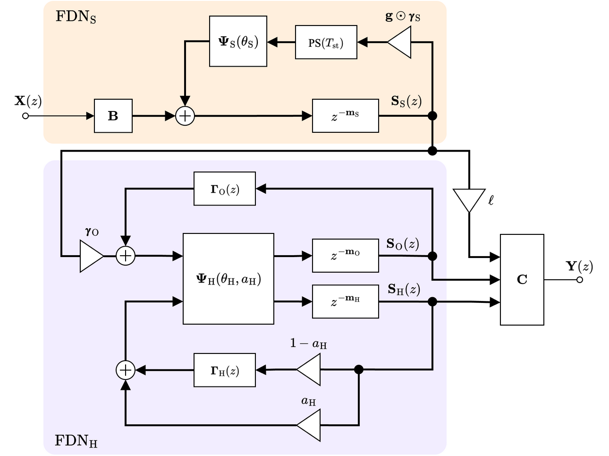
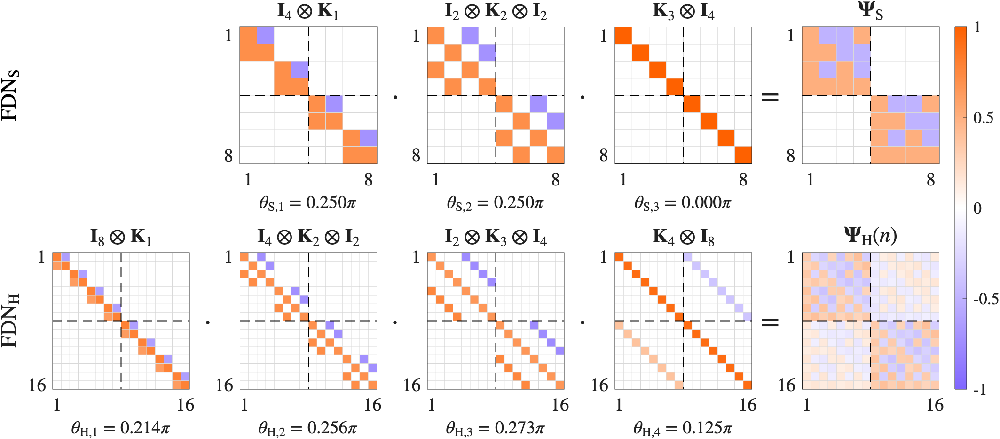
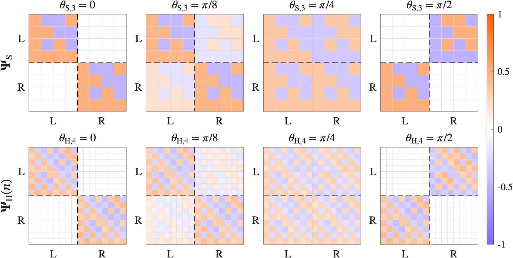
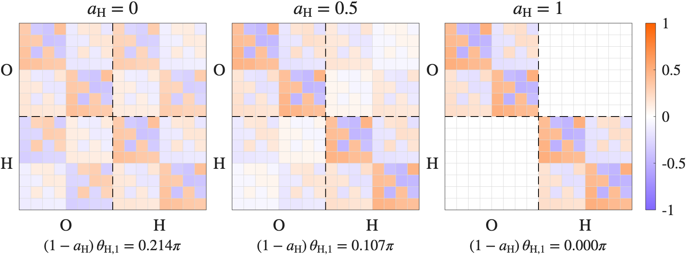

# Giving Wings to Shimmer Feedback Delay Networks

Companion repository for the abstract submitted to the Digital Music Research Network one-day workshop (DMRN+21), King's College London, 11 December 2026. See [`abstract.pdf`](abstract.pdf).

A stereo algorithm that combines time-varying operations and lossless parametric matrices in two coupled feedback delay networks (FDNs) [1] to produce an evolving shimmer reverberation effect. It builds on two papers presented at DAFx26:

- **Shimmer reverb via time compression and expansion in the FDN feedback loop:** G. Dal Santo, X. Pi, K. Prawda, S. J. Schlecht, and V. Välimäki, [*Shimmer reverberation with nonlinear feedback delay networks*](https://dafx.de/paper-archive/details/tLDBzbMbZN8aoERSiwvSpg) [2].
- **Creative modulation of the feedback matrix based on recursive Kronecker products:** A. Coppola, [*Fast parametric matrices for lossless feedback delay networks*](https://dafx.de/paper-archive/details/VlbuhJ67KqnHK13fcL2Bhw) [3].

BibTeX entries for both papers are in [Citing](#citing).

New to FDNs? An FDN is an artificial reverberation algorithm based on recirculating delay lines. If you want to learn more, you might find this useful: [delay-network-reverbs](https://github.com/gdalsanto/delay-network-reverbs).

## Audio examples

See [`clips/`](clips/). For now, there is only one example, showcasing pitch shifting, modulation, and freeze.

## How it works

<p align="center">
  
</p>
<p align="center"><em>Block diagram. Thin lines carry the stereo input and output; thick lines carry one signal per delay line.</em></p>

The structure has two FDNs: FDN<sub>S</sub> makes the tones climb, and FDN<sub>H</sub> sustains them.

- **FDN<sub>S</sub>, the shimmer network.** The stereo input $\mathbf X(z)$ enters only FDN<sub>S</sub>, through $\mathbf B$. As in [2], a pitch shifter (PS) in the loop transposes every delay line by $T_\text{st}$ semitones per pass, so that each pass adds a new tone to a recursive cascade. The transposition is set separately for the left and right lines. The PS reads a ring buffer through two crossfaded read pointers (see [Implementation details](#implementation-details)).
- **Handover.** Each delay-line output $\mathbf S_\text{S}(z)$ is split in two: a part scaled by $\gamma_{\text{S},i} = \cos\theta_{\text{SO},i}$ goes around the loop of FDN<sub>S</sub> again, and a part scaled by $\gamma_{\text{O},i} = \sin\theta_{\text{SO},i}$ enters a line of the open half of FDN<sub>H</sub>. Because $\gamma_{\text{S},i}^2 + \gamma_{\text{O},i}^2 = 1$, the split dissipates no energy: it only moves it from one network to the other. The angle

  ```math
  \theta_{\text{SO},i} = \arccos 10^{-3\tau_i/(T_\text{S} f_\text{s})},
  ```

  with $\tau_i$ the pass time of line $i$ in samples ($m_{\text{S},i}$ plus the PS latency), makes FDN<sub>S</sub> decay by 60 dB in the *shift time* $T_\text{S}$, which therefore sets how long the tones keep climbing. At $T_\text{S} = 0$ the input passes through FDN<sub>S</sub> once, untransposed, and FDN<sub>H</sub> works as a conventional reverberator. As $T_\text{S} \to \infty$ the structure reduces to the classic shimmer FDN of [2]. The gains $g_i$ are below 1 only when $T_\text{S}$ exceeds $T_{60,\text{dc}}$ (`t60_dc`), so that FDN<sub>S</sub> never decays more slowly than FDN<sub>H</sub>.
- **FDN<sub>H</sub>, the open-hold network.** FDN<sub>H</sub> has twice as many delay lines as FDN<sub>S</sub>, split into an *open* half O and a *hold* half H, with first-order attenuation filters $\mathbf\Gamma_\text{O}(z)$ and $\mathbf\Gamma_\text{H}(z)$ set by the reverberation times at dc and at Nyquist. There is no path from FDN<sub>H</sub> back into FDN<sub>S</sub>, so held tones are never transposed again. The hold amount $a_\text{H}$ freezes the hold half (see [Hold](#hold)).
- **Output.** $\mathbf Y(z) = \mathbf C [\ell \mathbf S_\text{S}; \mathbf S_\text{O}; \mathbf S_\text{H}]$, where the shimmer level $\ell$ balances the climbing tones of FDN<sub>S</sub> against the sustained tones of FDN<sub>H</sub>.

All parameters are listed with their code names and defaults under [Usage](#usage). The notation follows the block diagram above. In [`abstract.pdf`](abstract.pdf), $\mathbf\Psi_\text{S}$ is written $\mathbf U_\text{S}$ and $\mathbf\Psi_\text{H}$ is written $\mathbf\Psi$.

### In equations

Per sample, $\mathbf s_\text{S}(n)$ are the delay-line outputs of FDN<sub>S</sub> ($N/2$ lines, lengths $\mathbf m_\text{S}$). FDN<sub>H</sub> has $N$ lines, split into the open half O and the hold half H, with delay-line outputs $\mathbf s_\text{O}(n)$, $\mathbf s_\text{H}(n)$ and lengths $\mathbf m_\text{O}$, $\mathbf m_\text{H}$. The two halves are interleaved (in the code, 0-based, H is lines 0, 2, 4, … and O is lines 1, 3, 5, …), so that $\mathbf K_1$ pairs every open line with a hold line.

```math
\begin{aligned}
\mathbf s_\text{S}(n + \mathbf m_\text{S}) &= \mathbf\Psi_\text{S}\,\mathrm{PS}(\mathbf g \odot \boldsymbol\gamma_\text{S} \odot \mathbf s_\text{S}(n)) + \mathbf B\,\mathbf x(n) \\
\begin{bmatrix} \mathbf s_\text{O}(n + \mathbf m_\text{O}) \\ \mathbf s_\text{H}(n + \mathbf m_\text{H}) \end{bmatrix} &= \mathbf\Psi_\text{H}(n) \begin{bmatrix} \mathbf\Gamma_\text{O}\,\mathbf s_\text{O}(n) + \boldsymbol\gamma_\text{O} \odot \mathbf s_\text{S}(n) \\ \widetilde{\mathbf\Gamma}_\text{H}\,\mathbf s_\text{H}(n) \end{bmatrix} \\
\mathbf y(n) &= \mathbf C \begin{bmatrix} \ell\,\mathbf s_\text{S}(n) \\ \mathbf s_\text{O}(n) \\ \mathbf s_\text{H}(n) \end{bmatrix}
\end{aligned}
```

with $\boldsymbol\gamma_\text{S} = \cos\boldsymbol\theta_\text{SO}$, $\boldsymbol\gamma_\text{O} = \sin\boldsymbol\theta_\text{SO}$, $\widetilde{\mathbf\Gamma}_\text{H}(z) = (1 - a_\text{H}) \mathbf\Gamma_\text{H}(z) + a_\text{H}$, and $\mathbf\Psi_\text{S}$, $\mathbf\Psi_\text{H}(n)$ as in [Feedback matrices](#feedback-matrices). As in the paper and the block diagram, the FDN<sub>S</sub> equation leaves out the anti-aliasing lowpass ahead of the PS and the dc blocker after it.

### Implementation details

- **Safer pitch shifter.** Two read pointers, trapezoidal windows, and a crossfade normalised by the measured correlation of the two read-pointer outputs [5], instead of an equal-power crossfade (up to +3 dB per pass on correlated signals).
- **Passive filters.** The anti-aliasing lowpass, the dc blocker and the attenuation filters all have $\lvert H\rvert \le 1$; retuned filters crossfade old and new outputs.
- **Automation.** Every parameter is smoothed per sample: changes are click-free, and the output does not depend on the block size.

## Feedback matrices

Both feedback matrices are Kronecker products of $2 \times 2$ rotation kernels [4], applied as *butterfly* stages as in [3]:

```math
\mathbf K(\theta) = \begin{bmatrix} \cos\theta & -\sin\theta \\ \sin\theta & \cos\theta \end{bmatrix},
\qquad
\mathbf K_M(\theta_M) \otimes \dots \otimes \mathbf K_1(\theta_1) = \mathbf S_M \cdots \mathbf S_1,
\qquad
\mathbf S_i = \mathbf I_{2^{M-i}} \otimes \mathbf K_i \otimes \mathbf I_{2^{i-1}}.
```

- **Any angles are safe.** The product is orthogonal for any choice of the $M$ angles, so the angles can move over time, under LFOs or user control, without breaking the losslessness of the loop.
- **Fast.** Stage $\mathbf S_i$ mixes the pairs of lines that are $2^{i-1}$ apart, so a $2^M \times 2^M$ matrix costs $\mathcal O(N \log_2 N)$ per sample, as in a fast Walsh–Hadamard transform [3]. This is `pyFDN.kronecker_transform`.
- **Each angle has a meaning.** $\theta_i = 0$ leaves the pairs addressed by $\mathbf K_i$ unmixed, and $\theta_i = \pi/4$ mixes them equally. $\mathbf K_1$ mixes adjacent lines, and the outermost kernel mixes the first half of the lines with the second half.

With $N = 16$ delay lines in FDN<sub>H</sub> ($M = 4$) and $N/2 = 8$ in FDN<sub>S</sub>, the two matrices are

```math
\mathbf\Psi_\text{S} = \mathbf K_{M-1}(\theta_{\text{S},M-1}) \otimes \mathbf K_{M-2}(\pi/4) \otimes \dots \otimes \mathbf K_1(\pi/4),
```

```math
\mathbf\Psi_\text{H}(n) = \mathbf K_M(\theta_{\text{H},M}) \otimes \mathbf K_{M-1}\big(\theta_{\text{H},M-1}(n)\big) \otimes \dots \otimes \mathbf K_1\big((1 - a_\text{H})\,\theta_{\text{H},1}(n)\big).
```

The inner angles of $\mathbf\Psi_\text{S}$ are fixed at $\pi/4$ for maximal diffusion. In $\mathbf\Psi_\text{H}$, LFOs move the inner angles around $\pi/4$, $\theta_{\text{H},i}(n) = \pi/4 + d \sin(2\pi f_i n / f_\text{s} + \phi_i)$, to reduce coloration [3]. The rates $f_i$ are spread over one octave around $f_\text{mod}$, and the phases $\phi_i$ are random.

<p align="center"></p>
<p align="center"><em>Butterfly stages of the two feedback matrices at the default settings, and the matrices they multiply to. Top: Ψ<sub>S</sub> (8 lines, 3 stages). Bottom: Ψ<sub>H</sub>(n) (16 lines, 4 stages) at one time instant. Dashed lines separate the left-channel lines from the right-channel lines.</em></p>

### Stereo coupling

In both networks, the first half of the delay lines carries the left channel and the second half the right channel. The outermost kernel is therefore the only one that moves energy between the channels, and its angle is the stereo coupling:

- at $0$, the matrix is block diagonal, and the left and right channels are two independent networks;
- at $\pi/4$, every pass mixes the two channels equally;
- at $\pi/2$, $\cos\theta = 0$ and $\sin\theta = 1$, so the channels swap at every pass (one of them with its sign flipped).

<p align="center"></p>
<p align="center"><em>Ψ<sub>S</sub> (top) and Ψ<sub>H</sub>(n) (bottom) for four values of the stereo coupling, with all other angles at their defaults.</em></p>

The two couplings do different things:

- **In FDN<sub>S</sub>, $\theta_{\text{S},M-1}$ (`stereo_coupling_S`) shapes the harmonies.** At the default $0$, each channel builds its own cascade of tones, so the two channels can climb by different intervals, for example `transposition=(12, 7)` for +12 semitones on the left and +7 on the right. As $\theta_{\text{S},M-1}$ increases, part of each tone crosses to the other channel and is transposed by that channel's interval at the next pass, which produces combined intervals (+12 then +7 = +19 st). At $\pi/2$, every tone alternates between the channels and the two intervals alternate too.
- **In FDN<sub>H</sub>, $\theta_{\text{H},M}$ (`stereo_coupling_H`) spreads the sustained tail.** It sets how fast the held tones leak from the channel where they were generated into the other one: a fraction $\sin^2\theta_{\text{H},M}$ of the energy crosses at every pass, about 15 % at the default $\pi/8$.

### Hold

The lines of FDN<sub>H</sub> are interleaved: in 0-based indexing, the even lines form the hold half H and the odd lines form the open half O. The innermost kernel $\mathbf K_1$ therefore pairs every open line with a hold line, and $\theta_{\text{H},1}$ is the only angle that exchanges energy between the halves. Following [3], the hold amount $0 \le a_\text{H} \le 1$ (`hold_amount`) does two things:

1. It scales that angle to $(1 - a_\text{H}) \theta_{\text{H},1}(n)$.
2. It fades the attenuation filters of the hold half to unity, $\widetilde{\mathbf\Gamma}_\text{H}(z) = (1 - a_\text{H}) \mathbf\Gamma_\text{H}(z) + a_\text{H}$, which is the lower branch of the block diagram.

<p align="center"></p>
<p align="center"><em>Ψ<sub>H</sub>(n) for three hold amounts, with rows and columns reordered so that the open half O comes first and the hold half H second. The off-diagonal blocks exchange energy between the halves and vanish at a<sub>H</sub> = 1.</em></p>

- **At $a_\text{H} = 0$**, $\theta_{\text{H},1}$ stays near $\pi/4$, so the two halves mix equally on average and FDN<sub>H</sub> behaves as one 16-line reverberator, decaying as set by $\mathbf\Gamma_\text{O}(z)$ and $\mathbf\Gamma_\text{H}(z)$.
- **For $0 < a_\text{H} < 1$**, less energy crosses between the halves and the hold half decays more slowly.
- **At $a_\text{H} = 1$**, $\mathbf K_1 = \mathbf I$, and $\mathbf\Psi_\text{H}$ becomes block diagonal. The hold half is decoupled from the open half, it is lossless (an orthogonal matrix and unity filters), and it receives no input, because FDN<sub>S</sub> feeds only the open half. It sustains its content indefinitely. The LFOs keep moving the inner angles of its matrix, so the frozen sound keeps changing slowly. Meanwhile, the open half keeps receiving new tones from FDN<sub>S</sub> and decaying normally, so you can keep playing over the frozen tones.

FDN<sub>H</sub> is passive for every $a_\text{H}$ and every angle trajectory: $\mathbf\Psi_\text{H}(n)$ is always orthogonal, and $\lvert(1 - a_\text{H}) \Gamma_{\text{H},i}(e^{j\omega}) + a_\text{H}\rvert \le 1$ whenever $\lvert\Gamma_{\text{H},i}(e^{j\omega})\rvert \le 1$. Hold can therefore be engaged and released at any time. In the implementation, $a_\text{H}$ follows a 0.5 s S-shaped ramp so that the transition is click-free.

## Built on pyFDN

The time-domain processing builds on [pyFDN](https://github.com/artificial-audio/pyFDN), included as a submodule. The network is a `pyFDN.td.TimeOperator`, so it also works as a node in pyFDN graphs. Its delay lines are `pyFDN.td.RecursionState` banks; the Kronecker butterfly is `pyFDN.kronecker_transform`; the delay lengths come from `pyFDN.sample_delay_lengths`; and the attenuation filters come from `pyFDN.decay_to_one_pole`.

The pieces pyFDN does not have yet live in [`flyshim.td`](src/flyshim/td/), written as pyFDN operators so they can move upstream.

## Setup

```bash
git clone --recursive https://github.com/gdalsanto/dmrn21-butterfly-shimmer-fdn.git
cd dmrn21-butterfly-shimmer-fdn            # or, in an existing clone: git submodule update --init
conda create -n flyshim python=3.12 && conda activate flyshim
pip install --no-deps -e ./pyFDN           # pyFDN's own dependencies (FLAMO, torch) are not needed here
pip install -e ".[notebook,test]"
pytest                                     # 68 tests, about 20 s
```

For development, `pip install -e ".[dev]"` and `pre-commit install` (ruff with pyFDN's settings, and nbstripout, which clears notebook outputs before every commit).

## Usage

```python
import flyshim as fly

net = fly.ButterflyShimmerFDN(48000, shift_time=3.0, transposition=(12, 7), t60_dc=8.0)  # +12 st left, +7 st right
y = net.process_signal(x)  # x: (T,) mono or (T, 2) stereo -> y: (T, 2), wet only
net.set(hold_amount=1)     # reached smoothly; set(snap=True, ...) jumps
y = fly.render(net, x, [(2.0, {"hold_amount": 1}), (9.0, {"hold_amount": 0, "shift_time": 10.0})])  # scheduled changes
net.stored_energy()        # {"S": ..., "O": ..., "H": ...}: FDN_S, open half, hold half
```

| Parameter | Symbol | Default | |
|---|---|---|---|
| `shift_time` | $T_\text{S}$ | 3 s | shift time: FDN<sub>S</sub> decays by 60 dB in $T_\text{S}$, i.e. how long the tones climb (0 = no shift, `inf` = classic shimmer) |
| `transposition` | $T_\text{st,L/R}$ | (12, 12) st | transposition per pass, (left, right); a scalar sets both |
| `t60_dc` | $T_{60,\text{dc}}$ | 8 s | reverberation time of FDN<sub>H</sub> at dc (and of FDN<sub>S</sub> when $T_\text{S} > T_{60,\text{dc}}$) |
| `t60_ny` | $T_{60,\text{Ny}}$ | 4 s | reverberation time of FDN<sub>H</sub> at the Nyquist frequency |
| `hold_amount` | $a_\text{H}$ | 0 | hold amount, 0 to 1 |
| `mod_depth`, `mod_rate` | $d$, $f_\text{mod}$ | 0.05π, 0.3 Hz | depth and rate of the LFOs on $\mathbf\Psi_\text{H}$'s inner kernel angles |
| `stereo_coupling_S` | $\theta_{\text{S},M-1}$ | 0 | stereo coupling in FDN<sub>S</sub> (0 = a separate cascade per channel) |
| `stereo_coupling_H` | $\theta_{\text{H},M}$ | π/8 | stereo coupling in FDN<sub>H</sub> |
| `shimmer_level` | $\ell$ | 1 | output level of FDN<sub>S</sub> |

Fixed when the network is created: `n_shift` = 8 and `n_hold` = 16 lines (powers of two with `n_hold` ≥ 2 `n_shift`; the first half of each group is the left side), `shift_pass` = 90–160 ms and `hold_delays` = 25–90 ms (co-prime lengths within each group), the pitch shifter's `window` (2048 samples, ±12 % per line) and `crossfade` (0.25), `block_size`, and `seed`.

## Notebook

[`notebooks/demo.ipynb`](notebooks/demo.ipynb) is a minimal tour of the code. It runs `clips/dry.wav` and a sine burst through the network to show the shift time, a different transposition per channel, and hold; it schedules parameter changes with `render`, changes them live with `set`, and reads `stored_energy`. Every example is shown as a spectrogram, played inline, and saved as a WAV file in `notebooks/output/` (ignored by git). The notebook imports `flyshim` and pyFDN from this checkout, whether or not they are installed, and runs in about 20 s.

## Layout

```
src/flyshim/
  network.py         ButterflyShimmerFDN (the equations above) and render() for scheduled parameter changes
  mapping.py         shift time T_S -> handover angles theta_SO, T60 -> per-pass gains g
  control.py         per-sample parameter smoothers and a phase-accumulating LFO
  td/                pyFDN-style operators (candidates for upstreaming)
    pitch_shift.py   GainSafePitchShift
    filters.py       NormalizedDCBlocker, AntiAliasLowpass, HoldableAttenuationFilter
    kronecker.py     ControlledKroneckerMatrix
tests/               operators, mappings, handover, hold, stereo, automation
notebooks/           demo.ipynb: usage and audio examples
figures/             README figures: block diagram, feedback matrices, stereo coupling, hold
pyFDN/               submodule
```

## Citing

This project builds on the following two papers. If you use it, please cite them:

```bibtex
@inproceedings{dal2026shimmer,
  title     = {Shimmer reverberation with nonlinear feedback delay networks},
  author    = {Dal Santo, Gloria and Pi, Xiaojie and Prawda, Karolina and Schlecht, Sebastian J. and V{\"a}lim{\"a}ki, Vesa},
  booktitle = {Proc. 29th Int. Conf. Digital Audio Effects (DAFx26)},
  year      = {2026},
  pages     = {40--47}
}

@inproceedings{coppola2026fast,
  title     = {Fast parametric matrices for lossless feedback delay networks},
  author    = {Coppola, Andrea},
  booktitle = {Proc. 29th Int. Conf. Digital Audio Effects (DAFx26)},
  year      = {2026},
  pages     = {32--39}
}
```

## References

1. J.-M. Jot and A. Chaigne, "Digital delay networks for designing artificial reverberators," in *Proc. 90th Audio Eng. Soc. Conv.*, 1991.
2. G. Dal Santo, X. Pi, K. Prawda, S. J. Schlecht, and V. Välimäki, "[Shimmer reverberation with nonlinear feedback delay networks](https://dafx.de/paper-archive/details/tLDBzbMbZN8aoERSiwvSpg)," in *Proc. 29th Int. Conf. Digital Audio Effects (DAFx26)*, 2026, pp. 40–47.
3. A. Coppola, "[Fast parametric matrices for lossless feedback delay networks](https://dafx.de/paper-archive/details/VlbuhJ67KqnHK13fcL2Bhw)," in *Proc. 29th Int. Conf. Digital Audio Effects (DAFx26)*, 2026, pp. 32–39.
4. O. Das, E. K. Canfield-Dafilou, and J. S. Abel, "On the behavior of delay network reverberator modes," in *Proc. IEEE Workshop Appl. Signal Process. Audio Acoust. (WASPAA)*, 2019, pp. 50–54.
5. M. Fink, M. Holters, and U. Zölzer, "Signal-matched power-complementary cross-fading and dry-wet mixing," in *Proc. 19th Int. Conf. Digital Audio Effects (DAFx-16)*, 2016, pp. 109–112.
